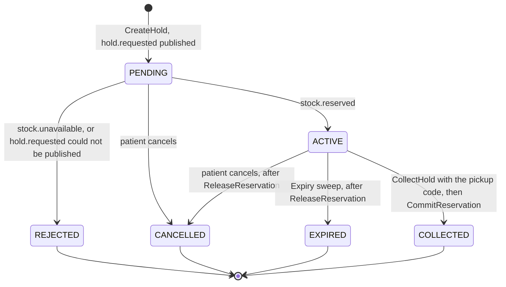
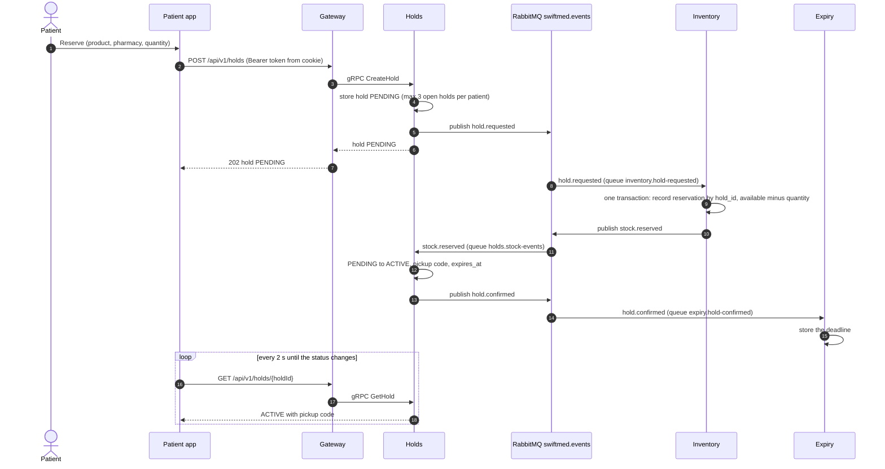
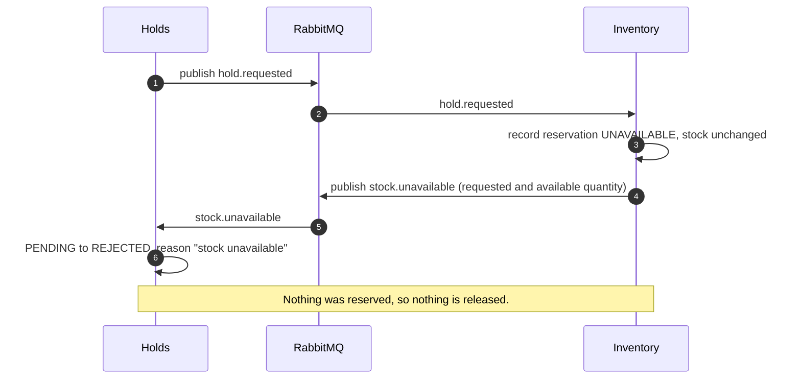
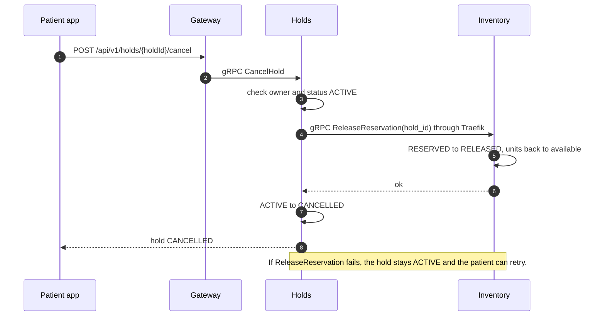
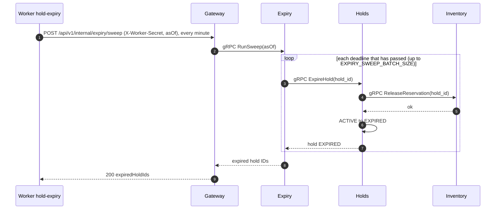
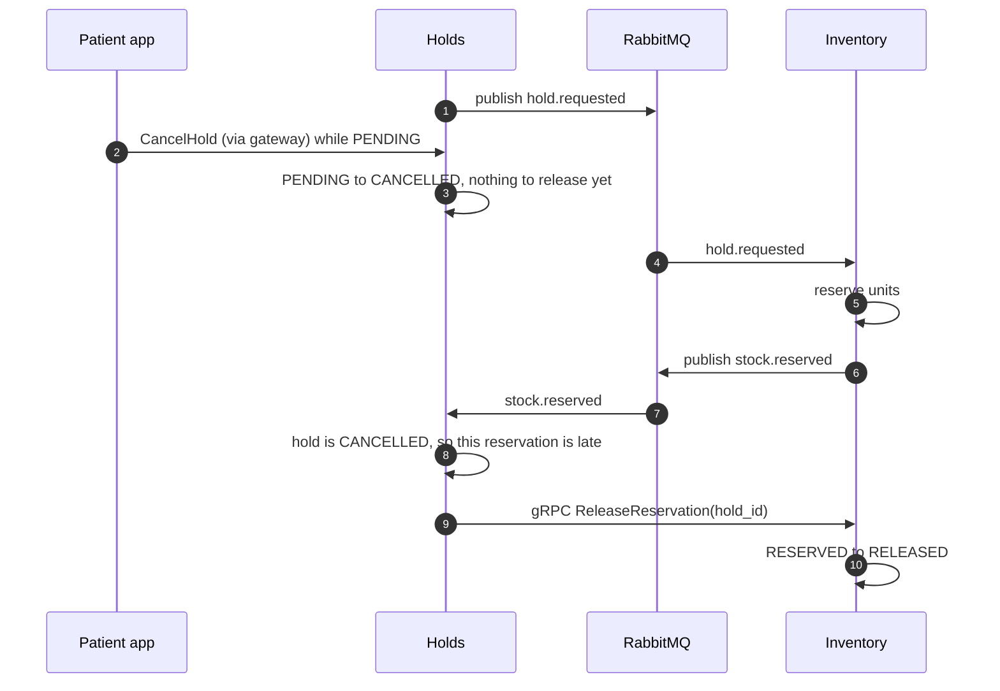

# Reservation saga

Back to [Architecture](README.md). Why it is a choreography: [ADR 0002](../adr/0002-choreographed-saga.md).

A hold reserves units of one product at one pharmacy for a short time (2 hours by
default, `HOLDS_HOLD_DURATION` and `EXPIRY_HOLD_DURATION`). Holds owns the hold and
its status; Inventory owns the stock. No service tells the others what to do: Holds
and Inventory react to each other's events on the `swiftmed.events` exchange, and
the steps that undo a reservation are direct gRPC calls to Inventory.

Code: `services/holds/internal/app/service.go` and `saga.go`,
`services/inventory/internal/app/service.go`,
`services/inventory/internal/adapters/postgres/reservation.go`,
`services/expiry/internal/app/service.go`.
Tests: `tests/integration/saga` (real Holds and Inventory, Postgres and RabbitMQ in
containers; the "Saga integration tests" CI job).

## Hold states

Inventory keeps its own record per hold in `inventory_reservations`, keyed by
`hold_id`: `UNAVAILABLE`, `RESERVED`, then `COMMITTED` or `RELEASED`. Only one of
commit and release can win, which settles races such as cancel against collect.

## 1. Happy path: stock reserved, hold confirmed

Every event carries `metadata.correlation_id` = the hold ID. Each consumer
deduplicates on the event ID, so a redelivered event changes nothing (test
`TestDuplicateEventsChangeNothing`).

## 2. No stock: hold rejected

If Holds cannot publish `hold.requested` at all, it rejects the hold at once
(reason "stock request could not be sent") so it does not count against the
patient's limit, and the gateway reports the error.

## 3. Compensation: the patient cancels an active hold

Inventory is called first and the hold is stored second, so a failed call never
leaves a cancelled hold holding stock. Releasing twice is safe: a reservation that
is already `RELEASED` (or was `UNAVAILABLE`) is returned unchanged.

## 4. Compensation: the hold expires

`ExpireHold` does nothing for a hold that is no longer ACTIVE, and the next sweep
retries anything that failed, so a sweep is safe to repeat (test
`TestExpiredHoldReleasesItsStock`).

## 5. Compensation: the stock was reserved after the patient cancelled

A patient can cancel while the hold is still PENDING. Holds cancels it at once;
if Inventory's `stock.reserved` arrives afterwards, Holds gives the stock back.

The same applies to a hold that is EXPIRED or REJECTED when `stock.reserved`
arrives (`HandleStockReserved` in `saga.go`).

## 6. Collecting

At the counter, `POST /api/v1/holds/{holdId}/collect` with the pickup code calls
`CollectHold`. Holds checks the pharmacy and code, calls Inventory
`CommitReservation` (the reserved units leave stock for good), then stores
COLLECTED. A wrong code leaves the hold ACTIVE.

## Failure handling

| Failure | What happens |
|---|---|
| A consumer's handler fails | `pkg/messaging` retries the delivery up to 3 times, then dead-letters it to `<queue>.dlq` |
| The same event arrives twice | Skipped by the deduplication table; Inventory's reservation is also keyed by `hold_id` |
| Holds publishes `hold.confirmed` but the publish fails | The `stock.reserved` delivery fails and is retried; the hold is already ACTIVE, so the retry only publishes `hold.confirmed` again |
| Inventory is unreachable on cancel or expire | The hold keeps its status; the patient retries the cancel, or the next sweep retries the expiry |
| Cancel and collect at the same moment | Inventory allows only one of release and commit per reservation; the hold update also checks the previous status |
