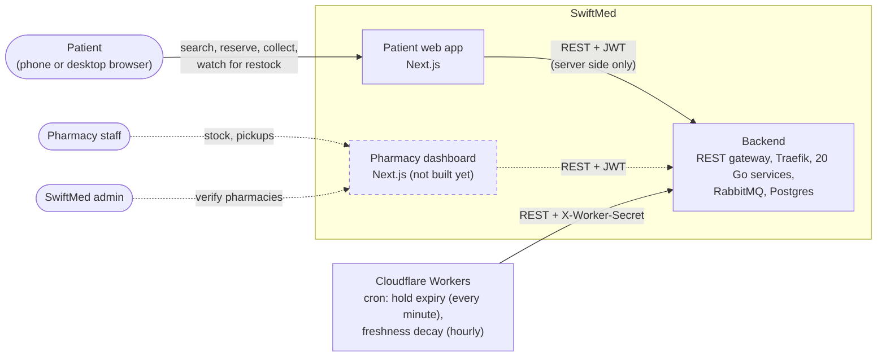
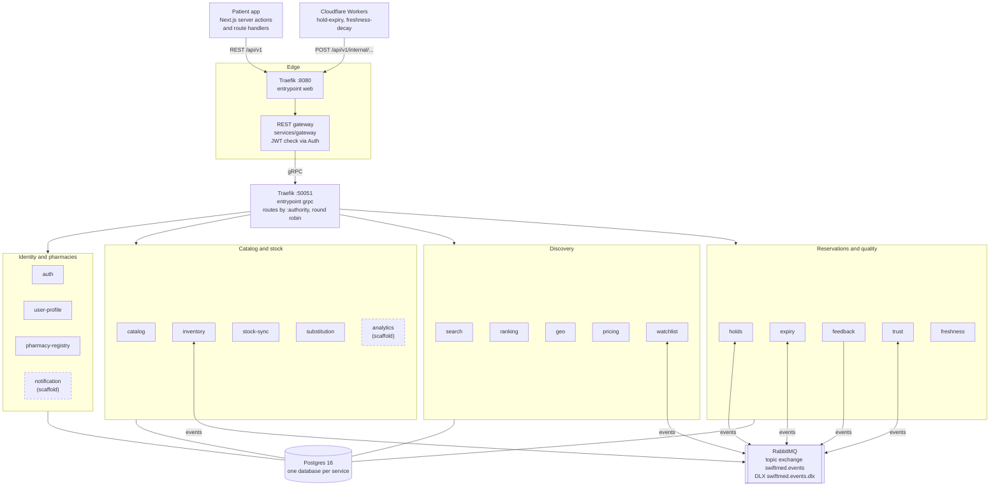
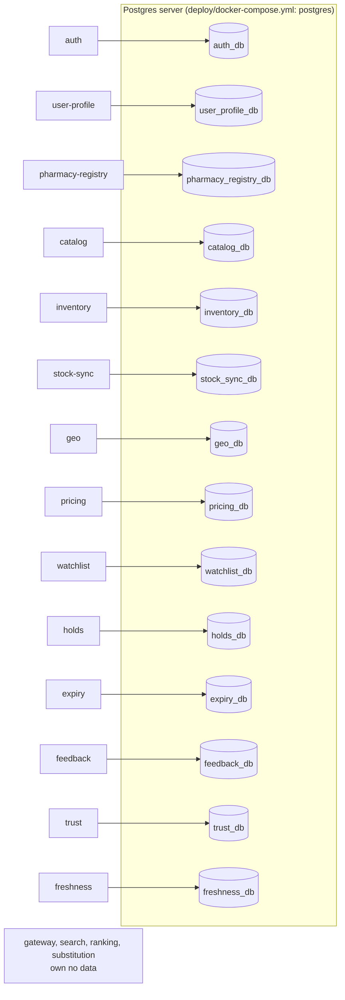
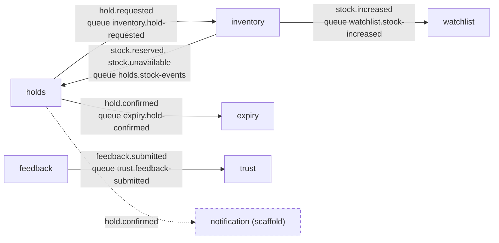
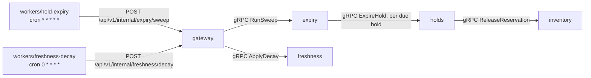
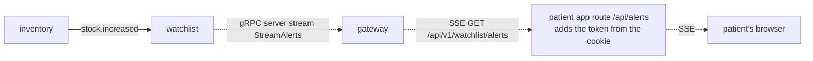

# System context and containers

Back to [Architecture](README.md).

Dashed boxes and dashed arrows are parts that exist only as scaffolding or are
planned; everything drawn solid runs in `deploy/docker-compose.yml` today.

## 1. System context

Who uses SwiftMed and what it depends on.

## 2. Containers

Every gRPC call, from the gateway or from one service to another, goes to
Traefik's `grpc` entrypoint (`traefik:50051`). Traefik picks the service by the
call's `:authority`, which the caller sets to the service name with
`grpc.WithAuthority` (`services/gateway/internal/grpcx/factory.go`). Services opt
in with Docker labels (``traefik.http.routers.<name>.rule=Host(`<name>`)``,
`scheme=h2c`) and are not published on the host.

The browser never talks to the gateway directly: the patient app's server code
calls `GATEWAY_URL`, so the access token stays in the `swiftmed_session` httpOnly
cookie (`web/patient-app/lib/auth.ts`, `app/actions.ts`). The gateway's port 8080
is the Traefik `web` entrypoint, which forwards everything to the gateway.

### Services

Owners are in the [README](../../README.md#team). Ports are the defaults in
`.env.example`. "Scaffold" means the folder has the hexagonal layout but no code
yet, and the service is not in Compose.

| Service | gRPC port | Database | Calls (through Traefik) | Events |
|---|---|---|---|---|
| gateway | 8080 (HTTP) | none | auth, search, geo, substitution, holds, watchlist, feedback, freshness, expiry | none |
| auth | 50051 | `auth_db` | none | none |
| user-profile | 50052 | `user_profile_db` | none | none |
| pharmacy-registry | 50053 | `pharmacy_registry_db` | none | none |
| notification | 50054 | `notification_db` (reserved) | scaffold | planned consumer of `hold.confirmed` |
| catalog | 50055 | `catalog_db` | none | none |
| inventory | 50056 | `inventory_db` | none | consumes `hold.requested`; publishes `stock.reserved`, `stock.unavailable`, `stock.increased` |
| stock-sync | 50057 | `stock_sync_db` | catalog, inventory, pricing | none |
| substitution | 50058 | none in Compose (`substitution_db` reserved) | catalog | none |
| analytics | 50059 | `analytics_db` (reserved) | scaffold | planned consumer of saga events |
| search | 50060 | none | catalog, geo, inventory, freshness, pricing, trust, pharmacy-registry, ranking, substitution | none |
| ranking | 50061 | none (pure scoring) | none | none |
| geo | 50062 | `geo_db` | none | none |
| pricing | 50063 | `pricing_db` | none | none |
| watchlist | 50064 | `watchlist_db` | geo | consumes `stock.increased` |
| holds | 50065 | `holds_db` | inventory (`ReleaseReservation`, `CommitReservation`) | publishes `hold.requested`, `hold.confirmed`; consumes `stock.reserved`, `stock.unavailable` |
| expiry | 50066 | `expiry_db` | holds (`ExpireHold`) | consumes `hold.confirmed` |
| feedback | 50067 | `feedback_db` | holds | publishes `feedback.submitted` |
| trust | 50068 | `trust_db` | none | consumes `feedback.submitted` |
| freshness | 50069 | `freshness_db` | none | none |

Search needs only Catalog, Geo and Inventory. Freshness, Pricing, Trust, Pharmacy
Registry, Ranking and Substitution are optional: if one does not answer (for
Trust, every offer then gets the neutral trust 0.5), results still come back and Search lists the missing service in
its `degraded` field (`services/search/internal/app/service.go`).

## 3. Data ownership

One Postgres server in Compose, one database per service, created by
`deploy/postgres/init/01-databases.sql`. Each service gets only its own
`<NAME>_DATABASE_URL` and applies its own migrations at startup
(`pkg/migrate`: `*.up.sql` files, a `schema_migrations` table and an advisory
lock, so two replicas never apply the same file twice). No service reads another
service's tables; it asks that service over gRPC or listens to its events.

`notification_db`, `analytics_db` and `substitution_db` are created too, ready
for those services.

## 4. Events

All events are protobuf messages on the topic exchange `swiftmed.events`
([proto/events/v1/events.proto](../../proto/events/v1/events.proto)). Every
consumer declares its own durable queue and a dead-letter queue. A delivery is
skipped if its message ID (the event ID) is already in that service's
`swiftmed_processed_events` table, retried up to 3 times on error, then sent to
`<queue>.dlq` (`pkg/messaging/consumer.go`).

## 5. Scheduled jobs

Both Workers call the gateway with the shared secret in `X-Worker-Secret`; the
gateway exempts exactly these two paths from the JWT check.

## 6. Back-in-stock alerts (in progress, SCRUM-71)

On `develop`, Watchlist already consumes `stock.increased`, asks Geo which waiting
subscribers have the pharmacy inside their radius, and records an alert for each
(`services/watchlist/README.md`). Delivering those alerts to the browser is being
built on SCRUM-71; the planned flow is:

On `develop`, `StreamAlerts` is defined in `proto/watchlist/v1/watchlist.proto`
but answers `UNIMPLEMENTED`.
